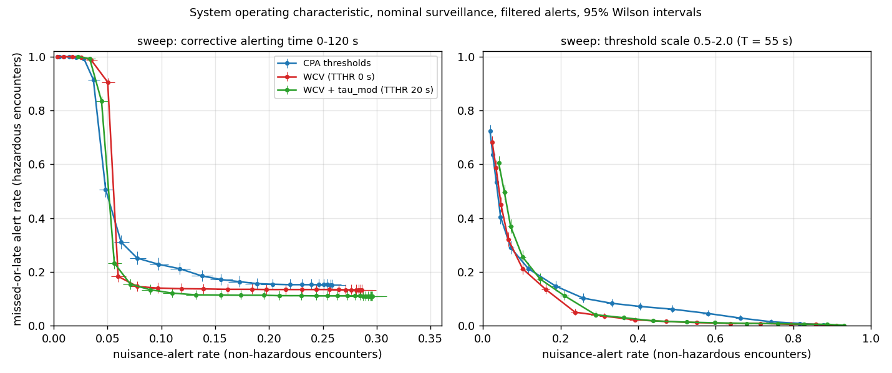
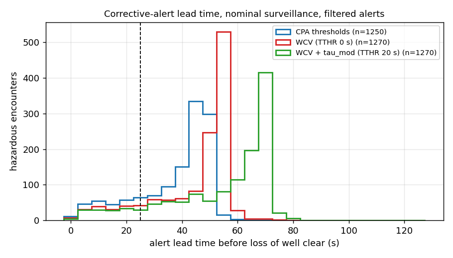

# eVTOL detect-and-avoid alerting and avoidance simulation

A personal project built in 2026 by Wenjie Luo. It compares detect-and-avoid (DAA)
alerting logics and avoidance manoeuvres for an eVTOL in low-altitude airspace, using
synthetic Monte-Carlo encounters. It is not certified, not derived from any real system,
and none of the encounter data comes from real traffic.

What is in the repository:

- `daa/` - Python simulator: encounter generator, surveillance and tracker model, three
  alerting logics with three alert tiers, four manoeuvre policies, metrics.
- `cpp/daa_core.hpp` - a small C++17 version of the CPA / well-clear core and the tiered
  alert function, with a command-line front end (`cpp/daa_cli.cpp`). The tests feed the same
  inputs to both implementations and require identical outputs.
- `scripts/run_eval.py` - the full evaluation (a few minutes on a laptop CPU; the measured
  run time is printed with the results), writing `results/` and `docs/*.png`.
- `scripts/make_readme.py` - renders the results section below from `results/summary.json`;
  `--check` fails if this README no longer matches the results files.
- `scripts/mutation_check.py` - plants deliberate bugs one at a time and checks that the test
  suite catches each one.

## Method

**Encounters.** Each encounter pairs the ownship (a level eVTOL heading along +x) with one
intruder: another eVTOL, a small multirotor drone or a light general-aviation (GA) aircraft.
The geometry class is head-on, crossing (30-150 deg), overtaking or vertical (intruder
climbing or descending through the ownship altitude). Each encounter is specified at the
closest point of approach (CPA) of the undisturbed straight-line paths - time to CPA
80-120 s, horizontal miss distance 0-1500 m, vertical offset +-300 m - and then propagated
back to t = 0. Encounters that start inside the well-clear volume, lose well clear in less
than 60 s, close slower than 5 m/s, or put the nominal intruder path outside 30-1200 m
altitude at any point in the full simulation horizon are rejected and counted. The
independent gust process is added afterwards and can take a realised path outside that
band; it is not clipped. Sampling uses batches, so accepted encounters plus rejection
counts need not sum to the number tried: surplus valid candidates are not retained.
20% of intruders make an unannounced 30-90 deg turn 10-60 s before
the nominal CPA, which a straight-line predictor cannot anticipate.

**Disturbances.** A steady uniform wind moves both aircraft equally and cancels out of the
relative motion, so it is not simulated. Gusts are modelled as an independent
Ornstein-Uhlenbeck velocity disturbance on each aircraft (time constant 20 s).

**Surveillance.** Ownship state is known exactly. Cooperative intruders (eVTOL, GA) report
position and velocity with noise; drones are non-cooperative and report position only.
Reports are lost according to a two-state (Gilbert) burst model. An alpha-beta tracker per
axis produces the intruder track; its gains come from the steady-state Kalman relations for
the constant-velocity model (checked against a Riccati iteration in the tests). Three
conditions: ideal (track = truth), nominal, degraded (3x noise, about 20% report loss).
For noisy surveillance, the first two reports are assumed received for track initiation.
A non-cooperative track starts with a zero velocity prior at t=0; its two-position
velocity estimate becomes available at the second report. It never uses a future report
to construct an earlier track state. Ideal surveillance remains a truth reference.

**Alerting logics.** All three use three tiers - preventive, corrective, warning - and the
alert level is the highest tier whose condition holds.

| logic | condition for a tier |
|---|---|
| CPA thresholds | intruder already inside the cylinder, or horizontal time to CPA in (0, T] with horizontal miss distance <= Dh and vertical separation at that time <= Dv |
| WCV | predicted well-clear violation (DAIDALUS `WCV_TAUMOD` test, TTHR = 0 s) at any time in [0, T] |
| WCV + tau_mod 20 s | as WCV with modified-tau threshold TTHR = 20 s |

The horizontal and vertical thresholds and alert times are the same for all three logics,
so the comparison isolates the logic rather than the numbers. With equal thresholds, a CPA
alert implies a WCV alert (at t = tcpa <= T the intruder is inside both bands; a test checks
this on 20,000 random states), so WCV can only add alerts: it trades nuisance alerts for
earlier ones, and the threshold sweeps compare the logics at equal nuisance rates. The well-clear violation test
is computed analytically as an interval of time (horizontal interval from the modified-tau
quadratic, intersected with the vertical interval), following the DAIDALUS source.
The horizontal interval is evaluated from cross-track miss distance and time to CPA to
avoid cancellation at exact tangency. Python and C++ require finite real state components
and finite nonnegative thresholds; invalid inputs are rejected. Geometry values outside
the supported finite arithmetic range are errors, not valid alert decisions.
Optionally the alert level is filtered: a level is raised only when present in 2 of the last
4 cycles and held until it has been absent for 5 cycles ("filtered" below; "raw" is
unfiltered).

**Avoidance.** On the first corrective alert the planner predicts the ownship path for 90 s
for each candidate manoeuvre (after a 5 s response delay, using the ownship turn-rate,
climb-rate and acceleration limits) against the intruder track extrapolated in a straight
line, and picks the cheapest candidate whose predicted separation stays outside 1.2x the
well-clear distances; if none does, the one with the largest predicted separation.

| policy | candidates |
|---|---|
| none | baseline, no manoeuvre |
| heading | heading change +-10 ... 90 deg; on ties the right turn is preferred (14 CFR 91.113 head-on and overtaking rules) |
| vertical | altitude change +-40 ... 200 m, only targets inside the 150-600 m band |
| combined | heading {0, +-20, +-40, +-60, +-90} deg x altitude {0, +-80, +-160} m |

On a warning alert every non-baseline policy escalates once to an emergency manoeuvre:
heading x altitude x {current speed, slow to 20 m/s}, choosing the largest predicted
separation regardless of cost. While a corrective or warning alert persists, the
manoeuvre in force is re-checked every 5 s against the latest track and replaced (after the
same response delay) if it is no longer predicted clear; section 5 of the results compares
this with a one-shot manoeuvre. The intruder never manoeuvres in response.

**Metrics.** The hazard is loss of well clear (LoWC) of the true, unmitigated trajectories,
checked in continuous time between 1 s samples.

- missed-or-late alert: a hazardous encounter whose corrective alert episode that is active
  at (or started most recently before) LoWC began less than 25 s before LoWC, or never. A
  flickering alert therefore counts from its latest restart; the table also shows the
  lenient version that credits the first alert.
- nuisance alert: a non-hazardous encounter that received any corrective or warning alert.
- lead time: LoWC onset minus start of that alert episode.
- with avoidance: LoWC and NMAC rates, LoWC risk ratio against no manoeuvre (paired
  bootstrap), share of encounters manoeuvred, share manoeuvred when no manoeuvre was
  needed, heading/altitude change, emergency escalations, and LoWC induced in encounters
  that were not hazardous without avoidance.
- system operating characteristic: the corrective alert time T (0-120 s) and, separately, a
  scale on the thresholds (0.5-2.0) are swept to trace missed-or-late against nuisance.

All strategies are evaluated on the same encounters, tracks and gust sequences, so
differences are paired (exact McNemar test and paired bootstrap).

## Sources and assumptions

Verified sources (fetched 2026-09-28):

- **[DAIDALUS]** NASA DAIDALUS v2.0.4a, `Configurations/DO_365B_no_SUM.conf` and
  `Java/src/gov/nasa/larcfm/ACCoRD/WCV_TAUMOD.java`, `WCV_tvar.java`,
  https://github.com/nasa/daidalus at commit `1c7b58e5525d5cca91cbbf4a8b7337a488243769`.
  DAIDALUS is NASA's open-source reference implementation of the RTCA DO-365 DAA alerting
  logic. The DO-365 document itself was not read; values below are as encoded in DAIDALUS.
- **[14 CFR 91.113]** US right-of-way rules, eCFR: aircraft approaching head-on each alter
  course to the right; an overtaking aircraft alters course to the right.
- **[Directory]** J. Meszaros, "Chinese eVTOL Aircraft Directory, Part 1", evtol.news
  (Vertical Flight Society), 2 May 2025,
  https://evtol.news/news/chinese-evtol-aircraft-directory-part-1 - quoted cruise speeds of
  passenger eVTOL designs between 200 and 300 km/h.

| parameter | value | source |
|---|---|---|
| well-clear volume (hazard) | DTHR 2200 ft (670.56 m), ZTHR 450 ft (137.16 m), TTHR 0 s | DAIDALUS `DWC_Non_Coop`; applying it to eVTOL traffic is an assumption |
| NMAC volume | 500 ft (152.4 m) horizontal, 100 ft (30.48 m) vertical | DAIDALUS `horizontal_nmac`, `vertical_nmac` |
| corrective / warning alert time | 55 s / 25 s | DAIDALUS `DWC_Non_Coop` alert_2 / alert_3 |
| preventive tier | ZTHR 700 ft (213.36 m), 55 s | ZTHR from DAIDALUS `DWC_Phase_I` alert_1; combining it with the Non-Coop DTHR is an assumption |
| alert filter | 2 of 4 cycles to raise, hold 5 cycles | M, N and 5 s from DAIDALUS (`alerting_m`, `alerting_n`, `hysteresis_time`); the filter itself is a simplification, not DAIDALUS's algorithm |
| modified-tau threshold of "WCV + tau_mod" | TTHR 20 s | assumption (DAIDALUS Phase I uses 35 s with a larger DTHR) |
| CPA logic thresholds | same as WCV | assumption (chosen for a like-for-like comparison) |
| required alert lead time | 25 s | assumption |
| response delay | 5 s | assumption |
| planner lookahead / buffer / re-check period | 90 s / 1.2x / 5 s | assumption |
| altitude band | 150-600 m | assumption |
| altitude-capture gain | 0.5 1/s | assumption |
| eVTOL speed | 55-70 m/s | range chosen inside the 200-300 km/h cruise speeds in [Directory]; the range itself is an assumption |
| eVTOL turn rate | g tan(30 deg)/V (4.6-5.9 deg/s over 55-70 m/s) | bank limit 30 deg is an assumption |
| eVTOL climb/descent, vertical accel., longitudinal accel. | 5 m/s, 0.25 g, 2 m/s^2 | assumption (0.25 g and 2 m/s^2 equal the DAIDALUS kinematic defaults, which are not eVTOL data) |
| drone / GA speed, climb | 8-20 m/s, 3 m/s / 45-65 m/s, 4 m/s | assumption |
| gusts | OU, sigma 1.0 / 2.0 / 1.0 m/s horizontal (eVTOL / drone / GA), tau 20 s | assumption |
| sensor noise | cooperative 10 m / 8 m / 0.5 m/s; non-cooperative 25 m / 20 m; degraded x3 | assumption |
| report loss | nominal P(lose)=0.02, P(recover)=0.5; degraded 0.05, 0.2 | assumption |
| encounter distribution | see Method | assumption, not fitted to traffic data |

Every parameter is in `config/default.json` with its source string.

## Results

<!-- BEGIN GENERATED RESULTS (scripts/make_readme.py) -->
All numbers below are produced by `scripts/run_eval.py` (seed 20260928, 6000 encounters) and rendered by `scripts/make_readme.py`. Brackets are 95% Wilson intervals for rates and 95% paired-bootstrap intervals for differences and ratios.

Encounter set: 6000 accepted of 12064 sampled (rejected: 175 slow closure, 230 loss too early, 2555 intruder altitude out of range). Geometry: head-on 1817, crossing 1806, overtaking 1503, vertical 874. Intruder: eVTOL 1962, drone 2082, GA 1956; 1235 intruders make an unannounced turn. Without avoidance, 1270/6000 = 21.2% [20.2, 22.2] of encounters lose well clear and 61/6000 = 1.0% [0.8, 1.3] reach NMAC. Surveillance report loss: nominal 3.8%, degraded 19.6%. Simulation and analysis time, excluding exports/plots: 140 s (Python 3.11.5, numpy 1.26.4).

### 1. Alerting performance (open loop, no avoidance), nominal surveillance, filtered alerts

| strategy | missed or late (lead < 25 s) | nuisance | median lead (s) | 10th pct lead (s) | alert episodes per hazardous enc. |
|---|---|---|---|---|---|
| CPA thresholds | 21.2% [19.0, 23.5] | 11.7% [10.8, 12.7] | 43.2 | 14.6 | 1.15 |
| WCV | 13.5% [11.8, 15.5] | 16.2% [15.1, 17.2] | 52.1 | 19.6 | 1.22 |
| WCV + tau_mod 20 s | 11.2% [9.6, 13.0] | 21.0% [19.8, 22.2] | 62.7 | 23.0 | 1.26 |

Threshold sweeps at matched nuisance: lowest missed-or-late rate among sweep points whose nuisance rate is at most the given cap (figure below shows all points).

| nuisance cap | swept parameter | CPA thresholds | WCV | WCV + tau_mod 20 s |
|---|---|---|---|---|
| <= 10% | alert time T | 22.8% [20.6, 25.2] at 50 s | 14.0% [12.2, 16.0] at 40 s | 13.4% [11.6, 15.4] at 25 s |
| <= 10% | threshold scale | 29.1% [26.6, 31.6] at 0.9x | 32.1% [29.6, 34.7] at 0.8x | 36.9% [34.3, 39.6] at 0.7x |
| <= 15% | alert time T | 18.5% [16.5, 20.7] at 60 s | 13.7% [11.9, 15.7] at 50 s | 11.5% [9.9, 13.4] at 35 s |
| <= 15% | threshold scale | 21.2% [19.0, 23.5] at 1x | 21.2% [19.0, 23.5] at 0.9x | 17.4% [15.4, 19.6] at 0.9x |
| <= 20% | alert time T | 15.7% [13.8, 17.8] at 75 s | 13.5% [11.7, 15.5] at 65 s | 11.3% [9.7, 13.2] at 45 s |
| <= 20% | threshold scale | 14.7% [12.9, 16.8] at 1.1x | 13.5% [11.8, 15.5] at 1x | 17.4% [15.4, 19.6] at 0.9x |

### 2. Surveillance quality and alert filtering

| surveillance | strategy | missed/late raw | missed/late filtered | nuisance raw | nuisance filtered | missed/late if first alert counted |
|---|---|---|---|---|---|---|
| ideal | CPA thresholds | 24.9% [22.6, 27.3] | 18.7% [16.6, 20.9] | 8.4% [7.6, 9.2] | 7.3% [6.6, 8.0] | 11.1% [9.5, 12.9] |
| ideal | WCV | 15.7% [13.8, 17.8] | 11.0% [9.4, 12.9] | 11.3% [10.4, 12.2] | 10.0% [9.2, 10.9] | 3.3% [2.5, 4.4] |
| ideal | WCV + tau_mod 20 s | 13.1% [11.3, 15.0] | 9.6% [8.1, 11.4] | 14.7% [13.7, 15.7] | 13.1% [12.2, 14.1] | 2.6% [1.9, 3.6] |
| nominal | CPA thresholds | 32.3% [29.8, 34.9] | 21.2% [19.0, 23.5] | 15.4% [14.4, 16.4] | 11.7% [10.8, 12.7] | 12.3% [10.6, 14.2] |
| nominal | WCV | 24.0% [21.7, 26.4] | 13.5% [11.8, 15.5] | 19.9% [18.8, 21.1] | 16.2% [15.1, 17.2] | 4.1% [3.1, 5.3] |
| nominal | WCV + tau_mod 20 s | 18.3% [16.2, 20.5] | 11.2% [9.6, 13.0] | 25.9% [24.7, 27.2] | 21.0% [19.8, 22.2] | 3.1% [2.3, 4.2] |
| degraded | CPA thresholds | 65.0% [62.3, 67.5] | 43.5% [40.8, 46.3] | 29.0% [27.7, 30.3] | 21.1% [20.0, 22.3] | 31.5% [29.0, 34.1] |
| degraded | WCV | 53.3% [50.6, 56.0] | 33.8% [31.2, 36.4] | 34.1% [32.8, 35.5] | 26.6% [25.4, 27.9] | 24.1% [21.8, 26.5] |
| degraded | WCV + tau_mod 20 s | 41.5% [38.8, 44.2] | 29.8% [27.4, 32.4] | 40.1% [38.7, 41.5] | 31.4% [30.1, 32.8] | 22.8% [20.5, 25.1] |

### 3. Paired comparisons on the same encounters (filtered alerts)

| surveillance | a - b | metric | n | difference | discordant a-only / b-only | McNemar exact p |
|---|---|---|---|---|---|---|
| nominal | WCV - CPA thresholds | missed_or_late | 1270 | -7.6 pts [-9.3, -6.0] | 10 / 107 | 1.2e-21 |
| nominal | WCV - CPA thresholds | nuisance | 4730 | +4.4 pts [+3.9, +5.1] | 210 / 0 | 1.2e-63 |
| nominal | WCV + tau_mod 20 s - WCV | missed_or_late | 1270 | -2.4 pts [-3.2, -1.6] | 0 / 30 | 1.9e-09 |
| nominal | WCV + tau_mod 20 s - WCV | nuisance | 4730 | +4.8 pts [+4.2, +5.5] | 228 / 0 | 4.6e-69 |
| nominal | WCV + tau_mod 20 s - CPA thresholds | missed_or_late | 1270 | -10.0 pts [-11.8, -8.3] | 6 / 133 | 2.7e-32 |
| nominal | WCV + tau_mod 20 s - CPA thresholds | nuisance | 4730 | +9.3 pts [+8.4, +10.1] | 438 / 0 | 2.8e-132 |
| degraded | WCV - CPA thresholds | missed_or_late | 1270 | -9.8 pts [-11.6, -8.0] | 11 / 135 | 2.7e-28 |
| degraded | WCV - CPA thresholds | nuisance | 4730 | +5.5 pts [+4.9, +6.2] | 260 / 0 | 1.1e-78 |
| degraded | WCV + tau_mod 20 s - WCV | missed_or_late | 1270 | -3.9 pts [-5.0, -2.9] | 1 / 51 | 2.4e-14 |
| degraded | WCV + tau_mod 20 s - WCV | nuisance | 4730 | +4.8 pts [+4.2, +5.4] | 227 / 0 | 9.3e-69 |
| degraded | WCV + tau_mod 20 s - CPA thresholds | missed_or_late | 1270 | -13.7 pts [-15.7, -11.8] | 4 / 178 | 1.5e-47 |
| degraded | WCV + tau_mod 20 s - CPA thresholds | nuisance | 4730 | +10.3 pts [+9.5, +11.2] | 487 / 0 | 5e-147 |

### 4. Closed loop: avoidance manoeuvres

| surveillance | alerting + policy | loss of well clear | NMAC count (rate) | LoWC risk ratio | manoeuvred | manoeuvred when not needed | mean max heading change (deg) | mean max altitude change (m) | emergency escalation | induced LoWC |
|---|---|---|---|---|---|---|---|---|---|---|
| nominal | no manoeuvre | 21.2% [20.2, 22.2] | 61 (1.02% [0.79, 1.30]) | 1 | 0.0% | 0.0% | - | - | 0.0% | 0 |
| nominal | CPA thresholds + heading | 1.3% [1.1, 1.7] | 0 (0.00% [0.00, 0.06]) | 0.063 [0.050, 0.077] | 30.0% | 11.6% | 20.8 | 2.2 | 2.8% | 3 |
| nominal | CPA thresholds + vertical | 3.2% [2.8, 3.7] | 1 (0.02% [0.00, 0.09]) | 0.151 [0.132, 0.171] | 29.8% | 11.4% | 7.9 | 122.0 | 5.9% | 0 |
| nominal | CPA thresholds + combined | 1.2% [0.9, 1.5] | 0 (0.00% [0.00, 0.06]) | 0.056 [0.044, 0.069] | 30.0% | 11.6% | 24.2 | 5.1 | 2.5% | 2 |
| nominal | WCV + heading | 0.7% [0.5, 0.9] | 0 (0.00% [0.00, 0.06]) | 0.033 [0.024, 0.043] | 33.8% | 16.1% | 19.7 | 1.9 | 2.9% | 5 |
| nominal | WCV + vertical | 0.8% [0.6, 1.0] | 0 (0.00% [0.00, 0.06]) | 0.036 [0.026, 0.047] | 33.6% | 15.8% | 11.8 | 120.2 | 7.3% | 1 |
| nominal | WCV + combined | 0.5% [0.3, 0.7] | 0 (0.00% [0.00, 0.06]) | 0.023 [0.015, 0.031] | 33.8% | 16.1% | 24.1 | 3.4 | 2.5% | 5 |
| nominal | WCV + tau_mod 20 s + heading | 0.5% [0.3, 0.7] | 0 (0.00% [0.00, 0.06]) | 0.022 [0.015, 0.030] | 37.5% | 20.7% | 22.4 | 1.8 | 5.5% | 1 |
| nominal | WCV + tau_mod 20 s + vertical | 0.3% [0.2, 0.5] | 0 (0.00% [0.00, 0.06]) | 0.015 [0.009, 0.022] | 37.1% | 20.3% | 23.1 | 106.5 | 11.9% | 0 |
| nominal | WCV + tau_mod 20 s + combined | 0.3% [0.2, 0.5] | 0 (0.00% [0.00, 0.06]) | 0.015 [0.009, 0.022] | 37.5% | 20.7% | 27.9 | 2.6 | 4.9% | 5 |
| degraded | no manoeuvre | 21.2% [20.2, 22.2] | 61 (1.02% [0.79, 1.30]) | 1 | 0.0% | 0.0% | - | - | 0.0% | 0 |
| degraded | CPA thresholds + heading | 4.2% [3.7, 4.7] | 4 (0.07% [0.03, 0.17]) | 0.198 [0.176, 0.221] | 36.2% | 20.7% | 27.7 | 7.2 | 8.9% | 15 |
| degraded | CPA thresholds + vertical | 6.6% [6.0, 7.2] | 7 (0.12% [0.06, 0.24]) | 0.310 [0.285, 0.335] | 35.8% | 20.2% | 19.9 | 105.1 | 14.6% | 9 |
| degraded | CPA thresholds + combined | 3.9% [3.4, 4.4] | 4 (0.07% [0.03, 0.17]) | 0.184 [0.163, 0.205] | 36.2% | 20.7% | 30.0 | 10.6 | 8.4% | 13 |
| degraded | WCV + heading | 3.3% [2.9, 3.8] | 3 (0.05% [0.02, 0.15]) | 0.155 [0.135, 0.175] | 41.1% | 26.4% | 28.9 | 8.4 | 11.3% | 9 |
| degraded | WCV + vertical | 3.5% [3.0, 4.0] | 4 (0.07% [0.03, 0.17]) | 0.164 [0.143, 0.185] | 40.7% | 25.8% | 25.5 | 102.4 | 17.8% | 8 |
| degraded | WCV + combined | 3.1% [2.7, 3.6] | 3 (0.05% [0.02, 0.15]) | 0.146 [0.127, 0.165] | 41.1% | 26.4% | 32.0 | 9.8 | 10.8% | 11 |
| degraded | WCV + tau_mod 20 s + heading | 2.8% [2.4, 3.2] | 4 (0.07% [0.03, 0.17]) | 0.130 [0.112, 0.148] | 45.1% | 31.1% | 33.6 | 8.9 | 16.1% | 5 |
| degraded | WCV + tau_mod 20 s + vertical | 2.5% [2.2, 3.0] | 4 (0.07% [0.03, 0.17]) | 0.120 [0.103, 0.139] | 44.8% | 30.7% | 37.3 | 88.9 | 24.8% | 3 |
| degraded | WCV + tau_mod 20 s + combined | 2.6% [2.2, 3.1] | 4 (0.07% [0.03, 0.17]) | 0.124 [0.105, 0.141] | 45.1% | 31.1% | 37.5 | 9.3 | 15.7% | 10 |

Paired differences in loss-of-well-clear rate:

| surveillance | a - b | difference | discordant a-only / b-only | McNemar exact p |
|---|---|---|---|---|
| nominal | wcv/heading - cpa/heading | -0.63 pts [-0.88, -0.40] | 7 / 45 | 7e-08 |
| nominal | wcv/vertical - wcv/heading | +0.07 pts [-0.17, +0.30] | 26 / 22 | 0.67 |
| nominal | wcv/combined - wcv/heading | -0.22 pts [-0.33, -0.10] | 1 / 14 | 0.00098 |
| nominal | wcv_tau/heading - wcv/heading | -0.23 pts [-0.37, -0.10] | 2 / 16 | 0.0013 |
| degraded | wcv/heading - cpa/heading | -0.92 pts [-1.18, -0.65] | 5 / 60 | 4.9e-13 |
| degraded | wcv/vertical - wcv/heading | +0.18 pts [-0.08, +0.47] | 41 / 30 | 0.24 |
| degraded | wcv/combined - wcv/heading | -0.18 pts [-0.33, -0.03] | 5 / 16 | 0.027 |
| degraded | wcv_tau/heading - wcv/heading | -0.53 pts [-0.75, -0.33] | 5 / 37 | 4.4e-07 |

### 5. Re-planning versus a one-shot manoeuvre

| surveillance | alerting + policy | LoWC one-shot | LoWC with re-planning | difference | discordant re-plan-only / one-shot-only | McNemar exact p |
|---|---|---|---|---|---|---|
| nominal | WCV + heading | 0.9% [0.7, 1.1] | 0.7% [0.5, 0.9] | -0.17 pts [-0.27, -0.07] | 0 / 10 | 0.002 |
| nominal | WCV + vertical | 1.0% [0.8, 1.3] | 0.8% [0.6, 1.0] | -0.27 pts [-0.47, -0.08] | 9 / 25 | 0.009 |
| nominal | WCV + tau_mod 20 s + heading | 0.7% [0.5, 0.9] | 0.5% [0.3, 0.7] | -0.20 pts [-0.32, -0.10] | 0 / 12 | 0.00049 |
| nominal | WCV + tau_mod 20 s + vertical | 0.6% [0.4, 0.8] | 0.3% [0.2, 0.5] | -0.28 pts [-0.43, -0.17] | 0 / 17 | 1.5e-05 |
| degraded | WCV + heading | 3.5% [3.1, 4.0] | 3.3% [2.9, 3.8] | -0.23 pts [-0.37, -0.12] | 0 / 14 | 0.00012 |
| degraded | WCV + vertical | 3.5% [3.1, 4.0] | 3.5% [3.0, 4.0] | -0.07 pts [-0.30, +0.17] | 21 / 25 | 0.66 |
| degraded | WCV + tau_mod 20 s + heading | 3.0% [2.6, 3.5] | 2.8% [2.4, 3.2] | -0.27 pts [-0.42, -0.13] | 2 / 18 | 0.0004 |
| degraded | WCV + tau_mod 20 s + vertical | 2.7% [2.4, 3.2] | 2.5% [2.2, 3.0] | -0.18 pts [-0.28, -0.08] | 0 / 11 | 0.00098 |

### 6. Pilot/automation response delay (WCV alerting, nominal surveillance)

| policy | delay 0 s: LoWC | delay 5 s: LoWC | delay 10 s: LoWC | delay 15 s: LoWC | delay 20 s: LoWC |
|---|---|---|---|---|---|
| heading | 0.2% [0.1, 0.3] | 0.7% [0.5, 0.9] | 1.1% [0.9, 1.5] | 1.7% [1.4, 2.0] | 3.4% [2.9, 3.8] |
| vertical | 0.2% [0.1, 0.4] | 0.8% [0.6, 1.0] | 1.2% [0.9, 1.5] | 2.2% [1.9, 2.6] | 7.4% [6.7, 8.1] |

### 7. Where it fails

Missed-or-late alerts (open loop, nominal, filtered), counted by mechanism. Labels overlap.

| strategy | total | no_alert_before_loss | alert_but_late | tcpa_beyond_T_at_required_time | vertical_outside_Dv_at_cpa | intruder_turned | drone_intruder |
|---|---|---|---|---|---|---|---|
| CPA thresholds | 269 | 20 | 249 | 65 | 65 | 85 | 95 |
| WCV | 172 | 0 | 172 | 7 | 45 | 66 | 81 |
| WCV + tau_mod 20 s | 142 | 0 | 142 | 7 | 36 | 62 | 57 |

Missed-or-late rate by encounter class (open loop, nominal, filtered):

| class | CPA thresholds | WCV | WCV + tau_mod 20 s |
|---|---|---|---|
| geometry=head_on | 13.9% [10.8, 17.9] (n=366) | 12.6% [9.6, 16.4] (n=366) | 9.8% [7.2, 13.3] (n=366) |
| geometry=crossing | 12.2% [9.4, 15.6] (n=435) | 11.3% [8.6, 14.6] (n=435) | 9.0% [6.6, 12.0] (n=435) |
| geometry=overtaking | 45.0% [39.2, 50.8] (n=278) | 20.9% [16.5, 26.0] (n=278) | 18.0% [13.9, 22.9] (n=278) |
| geometry=vertical | 20.9% [15.8, 27.3] (n=191) | 9.9% [6.5, 15.0] (n=191) | 8.9% [5.6, 13.8] (n=191) |
| intruder=evtol | 19.1% [15.4, 23.4] (n=377) | 9.8% [7.2, 13.2] (n=377) | 9.5% [7.0, 12.9] (n=377) |
| intruder=drone | 19.8% [16.5, 23.6] (n=480) | 16.9% [13.8, 20.5] (n=480) | 11.9% [9.3, 15.1] (n=480) |
| intruder=ga | 24.7% [20.8, 29.1] (n=413) | 13.1% [10.2, 16.7] (n=413) | 11.9% [9.1, 15.3] (n=413) |
| intruder_turn=straight | 17.6% [15.4, 20.0] (n=1047) | 10.1% [8.4, 12.1] (n=1047) | 7.6% [6.2, 9.4] (n=1047) |
| intruder_turn=turning | 38.1% [32.0, 44.6] (n=223) | 29.6% [24.0, 35.9] (n=223) | 27.8% [22.3, 34.0] (n=223) |

Residual losses of well clear with avoidance, labelled (labels overlap; `results/fail_cases.csv` lists every case with its encounter index):

| surveillance | alerting + policy | n_lowc | no_or_late_alert | no_conflict_free_candidate | intruder_turned | floor_or_ceiling_limited | drone_intruder | unmitigated_not_hazardous | none_of_first_four |
|---|---|---|---|---|---|---|---|---|---|
| nominal | CPA thresholds + heading | 80 | 57 | 68 | 53 | 7 | 26 | 3 | 0 |
| nominal | CPA thresholds + vertical | 192 | 95 | 180 | 51 | 87 | 74 | 0 | 2 |
| nominal | CPA thresholds + combined | 71 | 56 | 61 | 46 | 7 | 22 | 2 | 0 |
| nominal | WCV + heading | 42 | 18 | 39 | 40 | 3 | 9 | 5 | 0 |
| nominal | WCV + vertical | 46 | 19 | 46 | 25 | 21 | 21 | 1 | 0 |
| nominal | WCV + combined | 29 | 18 | 29 | 27 | 2 | 6 | 5 | 0 |
| nominal | WCV + tau_mod 20 s + heading | 28 | 14 | 27 | 27 | 1 | 5 | 1 | 0 |
| nominal | WCV + tau_mod 20 s + vertical | 19 | 14 | 19 | 16 | 4 | 4 | 0 | 0 |
| nominal | WCV + tau_mod 20 s + combined | 19 | 14 | 19 | 18 | 0 | 2 | 5 | 0 |
| degraded | CPA thresholds + heading | 252 | 209 | 192 | 100 | 11 | 197 | 15 | 8 |
| degraded | CPA thresholds + vertical | 394 | 245 | 343 | 106 | 101 | 259 | 9 | 2 |
| degraded | CPA thresholds + combined | 234 | 202 | 175 | 87 | 14 | 189 | 13 | 6 |
| degraded | WCV + heading | 197 | 164 | 139 | 72 | 10 | 166 | 9 | 6 |
| degraded | WCV + vertical | 208 | 165 | 155 | 62 | 29 | 180 | 8 | 2 |
| degraded | WCV + combined | 186 | 163 | 126 | 63 | 12 | 165 | 11 | 5 |
| degraded | WCV + tau_mod 20 s + heading | 165 | 143 | 121 | 55 | 12 | 139 | 5 | 2 |
| degraded | WCV + tau_mod 20 s + vertical | 153 | 146 | 113 | 42 | 16 | 139 | 3 | 0 |
| degraded | WCV + tau_mod 20 s + combined | 157 | 144 | 114 | 47 | 13 | 140 | 10 | 2 |

### 8. Test-suite mutation check

`scripts/mutation_check.py` planted 29 deliberate bugs, one at a time, in fresh copies of the repository; tests detected 29 of 29. The unmutated copy passed first (236 passed in 59.44s).
Every case must compile the C++ core before pytest. Collection, setup, compiler, timeout and skipped-test outcomes invalidate the run rather than count as detections. The report retains per-case failure evidence and full logs/JUnit files.

The archived initial implementation's first run caught 24 of 25; the survivor (C++ CPA time boundary < instead of <=) led to exact-threshold tests. That file is historical evidence, not a rerun of the current source or current mutation harness.

| # | file | planted bug | result |
|---|---|---|---|
| 0 | `daa/geometry.py` | scalar tcpa sign flipped | caught |
| 1 | `daa/geometry.py` | vectorised CPA not clamped to t >= 0 | caught |
| 2 | `daa/geometry.py` | scalar circle exit uses wrong root | caught |
| 3 | `daa/geometry.py` | vectorised tau_mod entry sign | caught |
| 4 | `daa/geometry.py` | vectorised vertical interval bound | caught |
| 5 | `daa/geometry.py` | lookahead time ignored | caught |
| 6 | `daa/geometry.py` | CPA time threshold doubled (vectorised) | caught |
| 7 | `daa/geometry.py` | loss onset takes last segment | caught |
| 8 | `daa/alerting.py` | tier index lost | caught |
| 9 | `daa/alerting.py` | M-of-N off by one | caught |
| 10 | `daa/alerting.py` | hold time off by one | caught |
| 11 | `daa/metrics.py` | Wilson half-width term dropped | caught |
| 12 | `daa/metrics.py` | required lead boundary | caught |
| 13 | `daa/metrics.py` | alerts after onset counted | caught |
| 14 | `daa/sim.py` | turn rate limit doubled | caught |
| 15 | `daa/sim.py` | vertical acceleration unbounded | caught |
| 16 | `daa/sim.py` | left-turn preference | caught |
| 17 | `daa/sim.py` | altitude floor ignored | caught |
| 18 | `daa/sim.py` | response delay ignored | caught |
| 19 | `daa/sensors.py` | alpha-beta gain formula | caught |
| 20 | `daa/sensors.py` | dropout recovery inverted | caught |
| 21 | `daa/encounters.py` | encounter back-propagation sign | caught |
| 22 | `cpp/daa_core.hpp` | C++ circle exit perturbed by 1e-9 | caught |
| 23 | `cpp/daa_core.hpp` | C++ tier off by one | caught |
| 24 | `cpp/daa_core.hpp` | C++ CPA time boundary < instead of <= | caught |
| 25 | `daa/sensors.py` | noncooperative initial velocity leaks future report | caught |
| 26 | `daa/sim.py` | emergency chooses cheapest clear instead of maximum separation | caught |
| 27 | `daa/encounters.py` | generator altitude check stops before full horizon | caught |
| 28 | `daa/metrics.py` | paired metrics accept unequal input lengths | caught |




<!-- END GENERATED RESULTS -->

## Findings

These statements refer to the tables above and hold for this synthetic setup only.

1. At the default thresholds, both WCV logics give fewer missed-or-late alerts than the CPA
   logic on the same encounters, and more nuisance alerts (tables 1 and 3). Sweeping the
   alert time, the WCV logics have the lower missed-or-late rate at every nuisance cap in the
   matched-nuisance table. In the distance-scale sweep at a 10% nuisance cap, however,
   CPA has the lowest missed-or-late point estimate (29.1%, versus 32.1% for WCV and
   36.9% for WCV + tau_mod). These are selected sweep points, not a paired non-inferiority
   test. WCV does not have a uniformly better trade-off over all parameter choices.
2. In the nominal filtered breakdown, CPA has its highest missed-or-late rate in overtaking
   encounters (45.0%); the vertical class is also challenging (20.9%). Rates and counts
   differ: the smaller vertical class contributes 40 cases, versus 51 head-on and 53 crossing.
   The mechanism flags show both time-to-CPA staying beyond the alert horizon and predicted
   vertical separation at horizontal CPA outside the vertical threshold; those flags can overlap.
3. For both WCV logics in the nominal filtered breakdown, encounters in which the intruder
   makes an unannounced turn have the
   highest missed-or-late rate of any class, several times the rate with straight-flying
   intruders; every logic here extrapolates straight lines.
4. The alert metric matters. Raw alerts flicker under noise and report loss; crediting the
   first alert makes every logic look much better than counting from the alert episode that
   is active at, or started most recently before, loss of well clear (table 2).
   The 2-of-4 raise / 5-cycle hold
   filter lowered both missed-or-late and nuisance rates for every logic in all three
   surveillance conditions.
5. Every tested avoidance configuration has fewer losses than the no-manoeuvre baseline.
   Policy ranking depends on alert logic: with WCV, vertical versus heading losses are
   46 versus 42 under nominal surveillance and 208 versus 197 under degraded surveillance;
   the paired differences are inconclusive (McNemar p=0.665 and 0.235; both difference
   intervals cross zero). With WCV + tau_mod, vertical has fewer losses than heading in
   both conditions. WCV combined has fewer losses than WCV heading in both conditions
   (section 4); this does not establish a universal best policy.
6. With a one-shot manoeuvre, WCV + tau_mod has fewer residual losses than WCV in all four
   condition/policy pairs in section 5. Re-checking every 5 s lowers the observed count
   in all eight configurations, but the improvement is not uniformly supported by the
   paired tests: degraded WCV vertical changes from 212 to 208, with p=0.659 and a
   difference interval crossing zero. The earlier-alerting WCV + tau_mod also has lower
   observed losses in these one-shot comparisons.
7. In the nominal-surveillance WCV delay sweep, residual losses grow with response delay,
   most steeply between 15 and 20 s. Vertical avoidance is more sensitive to delay than
   heading avoidance over these tested settings (section 6).
8. In each degraded-surveillance configuration, most residual losses involve
   non-cooperative drones. The sensor model assigns them noisier, position-only reports;
   this association is not an isolated causal estimate of sensor quality.

## Limitations

- Synthetic encounters. The mix of geometries, miss distances and intruder types is chosen,
  not measured, and every rate above depends on it. The rates are useful for comparing
  logics on the same encounters, not as estimates of real-world risk.
- Rejection sampling (nominal intruder altitude limits over the full horizon) removes many
  steep vertical encounters. The vertical class is the smallest (874 of 6000); no claim
  about real traffic composition follows from this constructed sample.
- Loss of well clear without avoidance defines "hazardous"; an encounter that stays just
  outside the volume counts as non-hazardous, so a well-timed alert on it counts as nuisance.
- Performance, noise, gust and dropout values are assumptions (see table). No aircraft or
  sensor data was used.
- Point-mass kinematics with first-order limits; no aerodynamics, no flight control system,
  no transition-phase behaviour of lift+cruise eVTOLs.
- Pairwise encounters only. Terrain is represented only by an altitude floor; there are no
  weather cells, buildings or multi-intruder conflicts.
- Intruders never coordinate or respond. Real cooperative traffic may manoeuvre too.
- Alert filtering and the planner are my simplifications. They are inspired by DAIDALUS
  but are not DAIDALUS, and DO-365 compliance was not assessed.
- Human factors are only represented by a fixed response delay and by lead-time and alert
  flicker metrics; no pilot-in-the-loop study was done.

## Reproduce

```
pip install -r requirements.txt
python -m pytest -q                      # needs g++, clang++ or MSVC for the C++ agreement tests
python scripts/run_eval.py               # writes results/ and docs/
python scripts/mutation_check.py         # optional, runs an unmutated control then each deliberate bug
python scripts/make_readme.py            # refresh the results section
python scripts/make_readme.py --check    # fails if README and results disagree
```

The `.github/workflows/ci.yml` workflow builds C++ on Ubuntu and Windows, runs the tests with
`DAA_REQUIRE_CPP=1` (so the agreement tests cannot be skipped) and checks the generated
README results block. A real compiler regression builds and runs the core from paths
containing Unicode, spaces and shell characters; Windows explicitly exercises MSVC.
The hand-written Findings and Limitations require separate review after an evaluation.

The published [mutation report](results/mutation_report.json) links each case to its own
compile log, pytest log and JUnit record in [mutation_evidence.zip](results/mutation_evidence.zip).
Extract the archive beside the report to resolve those relative paths. The report includes
the exact source/test/config and archive-member hashes used for this gate; local reruns
retain their evidence in a separate `*_artifacts/run_*` directory.

The October 2026 reliability review fixes tangency cancellation, future-report leakage
at tracker initialisation, emergency candidate selection, full-horizon altitude screening,
paired-input validation and Unicode MSVC builds. The results above were rerun with all
6000 encounters after those fixes, using the pinned requirements. Historical results remain
in commit `3162ee8874f53e9970e1bfe4b4a8fdab32b2a3b7`. Changed sampling eligibility changes
the accepted encounters and later random draws; old/new encounter indices must not be
paired, even though the seed is the same. The historical run also used NumPy 1.24.3,
whereas this run uses 1.26.4, so aggregate changes are not isolated algorithm gains.

`summary.json` records the runtime source/config SHA-256 values (raw checkout bytes,
including line endings). The evaluator rejects a source change during the calculation
before publishing its outputs. `--n` must be a positive integer; use explicit `--out` and
`--docs` directories to preserve a prior evaluation while running another one.
